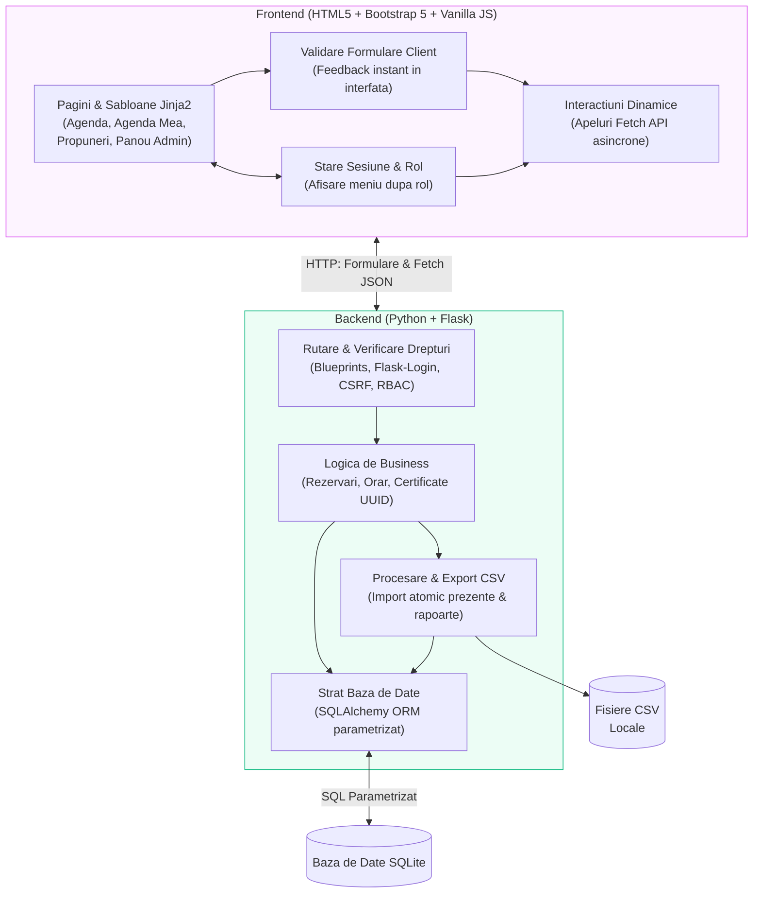

# Arhitectura Aplicatiei

[Inapoi la README](../README.md)

## 1. Structura Generala

Aplicatia are o arhitectura simpla de tip Client-Server:

- **Client (Frontend):** Interfata web ruleaza in browserul utilizatorului (pagini HTML5 randate de server si JavaScript vanilla) si gestioneaza afisarea agendei, formularele si cererile asincrone prin Fetch API.
- **Server (Backend in Python / Flask):** Gestioneaza cererile HTTP, autentificarea pe roluri, regulile de rezervare si programare, precum si comunicarea cu baza de date.
- **Baza de date (SQLite):** Fisier local (`techpulse.db`) gestionat prin SQLAlchemy ORM, care asigura salvarea persistenta a utilizatorilor, salilor, sesiunilor, rezervarilor, feedback-ului si certificatelor.
- **Stocare locala fisiere CSV:** Fisiere locale cu listele de prezenta importate la ateliere si rapoartele exportate pentru administratori.

## 2. Diagrama Arhitecturala



## 3. Descrierea Componentelor

### 3.1. Frontend

- **Module de Interfata (HTML5 + Bootstrap 5 + Jinja2):** Pagini separate care corespund fluxurilor din aplicatie:
  - **Agenda Publica (`/agenda`):** Afisarea atelierelor programate, locurile ramase si filtrare dupa categorie sau nivel.
  - **Agenda Mea (`/my-schedule`):** Lista sesiunilor rezervate de student, buton de anulare, formular de feedback si link catre certificat.
  - **Propunere Sesiune (`/proposals/new`):** Formular pentru speakeri (titlu, categorie, nivel, durata, prerechizite, disponibilitate orara).
  - **Panou Administrator (`/admin`):** Tabel pentru aprobarea/respingerea propunerilor, alocarea salilor, import prezente CSV si export raport.
  - **Certificat Digital (`/certificates/<id>`):** Pagina cu serie unica, pregatita pentru tiparire PDF din browser (`@media print`).
- **Validare pe Client:** Verifica datele inainte de trimitere (campuri obligatorii completate, note intre 1 si 5) pentru a oferi erori rapide direct in pagina.
- **Sesiune si Autentificare:** Meniul si optiunile vizibile se adapteaza automat in sabloane in functie de rolul utilizatorului logat (`PARTICIPANT`, `SPEAKER`, `ADMIN`).
- **Apeluri Asincrone (Fetch API):** Script JavaScript care trimite cererile de rezervare loc, anulare si filtrare agenda in format JSON si actualizeaza contorul de locuri fara reincarcarea paginii.

### 3.2. Backend

- **Rutare HTTP (Flask Blueprints):** Imparte rutele pe module (`auth`, `agenda`, `registrations`, `proposals`, `feedback`, `certificates`, `admin`) pe baza metodei (`GET`, `POST`) si a URL-ului.
- **Autentificare si Drepturi (Flask-Login):** Verifica sesiunea cookie HTTP-only si rolul utilizatorului. Daca un cont obisnuit incearca sa acceseze rute de administrare (`/admin/*`), serverul refuza cererea direct cu codul `403 Forbidden`.

### 3.3. Logica de Aplicatie si Servicii

- **Rute si Validare:** Preiau datele din formulare sau JSON, verifica token-ul CSRF, scapa textul impotriva XSS si apeleaza functiile de business.
- **Rezervari si Programare:** Verifica pe server locurile disponibile, previn inscrierile duble sau suprapunerile orare si blocheaza coliziunile de sala/speaker la aprobarea propunerilor.
- **Import CSV Atomic:** Citeste fisierul `.csv` cu prezente linie cu linie in memorie. Daca toate randurile sunt valide, actualizeaza prezenta in baza de date; daca exista o singura eroare, anuleaza tot importul si afiseaza erorile pe linii.
- **Export CSV:** Extrage statisticile sesiunilor din SQLite si genereaza pe loc un fisier `.csv` pe care administratorul il poate descarca direct din browser.

### 3.4. Baza de Date

- **Organizarea interogarilor (SQLAlchemy ORM):** Modelele tabelelor (`users`, `rooms`, `categories`, `sessions`, `registrations`, `feedback`, `certificates`) si interogarile sunt separate de logica de rute pentru a pastra codul ordonat.
- **Protectie SQL Injection:** Toate interogarile folosesc parametri prin ORM, astfel incat textul trimis de utilizatori sa nu poata modifica comanda SQL.
- **Integritate date:** Constrangeri `UNIQUE` pe email si perechea `(user_id, session_id)`, plus separarea tabelei `feedback` de `users` pentru anonimizarea recenziilor.

## 4. Structura de Directoare a Proiectului

```text
techpulse/
├── app/
│   ├── __init__.py
│   ├── models.py
│   ├── routes/
│   ├── services/
│   ├── templates/
│   └── static/
│       ├── css/
│       └── js/
├── instance/
│   └── techpulse.db
├── data/
└── docs/
    ├── wireframes/
    ├── architecture.md
    ├── data-model.md
    ├── requirements.md
    └── use-cases.md
```
