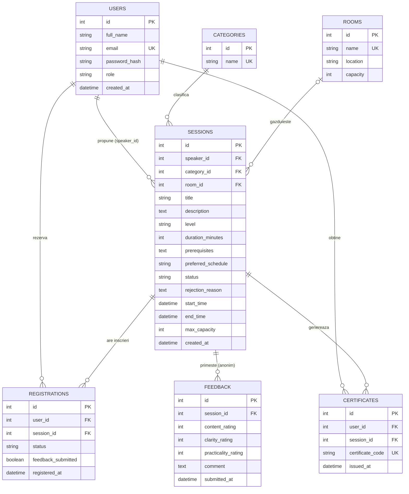

# Modelul de Date si Specificatia Rutelor

[Inapoi la README](../README.md)

---

## 1. Schema Bazei de Date (SQLite / SQLAlchemy)

### Tabela `users`
Conturile utilizatorilor (participanti, speakeri si administratori).
- `id` (INTEGER PRIMARY KEY AUTOINCREMENT)
- `full_name` (VARCHAR(100) NOT NULL) – numele afisat in agenda si pe certificat.
- `email` (VARCHAR(255) UNIQUE NOT NULL)
- `password_hash` (TEXT NOT NULL) – stocat exclusiv prin hash criptografic (`werkzeug.security`).
- `role` (VARCHAR(20) NOT NULL DEFAULT 'PARTICIPANT') – valori permise: `PARTICIPANT`, `SPEAKER`, `ADMIN`.
- `created_at` (DATETIME NOT NULL DEFAULT CURRENT_TIMESTAMP)

### Tabela `rooms`
Salile si laboratoarele disponibile pentru conferinta.
- `id` (INTEGER PRIMARY KEY AUTOINCREMENT)
- `name` (VARCHAR(100) UNIQUE NOT NULL) – ex: "Aula Magna", "Lab 204".
- `location` (VARCHAR(150) NOT NULL) – cladirea / etajul.
- `capacity` (INTEGER NOT NULL CHECK (capacity > 0)) – capacitatea maxima a salii.

### Tabela `categories`
Categoriile tehnice ale atelierelor (ex: Web, AI, Securitate, DevOps).
- `id` (INTEGER PRIMARY KEY AUTOINCREMENT)
- `name` (VARCHAR(80) UNIQUE NOT NULL)

### Tabela `sessions`
Propunerile de ateliere si sesiunile programate in agenda.
- `id` (INTEGER PRIMARY KEY AUTOINCREMENT)
- `speaker_id` (INTEGER NOT NULL REFERENCES users(id) ON DELETE CASCADE)
- `category_id` (INTEGER NOT NULL REFERENCES categories(id))
- `room_id` (INTEGER NULL REFERENCES rooms(id)) – completat la aprobare.
- `title` (VARCHAR(200) NOT NULL)
- `description` (TEXT NOT NULL)
- `level` (VARCHAR(20) NOT NULL) – valori permise: `BEGINNER`, `INTERMEDIATE`, `ADVANCED`.
- `duration_minutes` (INTEGER NOT NULL CHECK (duration_minutes > 0))
- `prerequisites` (TEXT NULL) – cerinte tehnice pentru participanti.
- `preferred_schedule` (VARCHAR(150) NULL) – preferinta orara indicata de speaker la propunere.
- `status` (VARCHAR(20) NOT NULL DEFAULT 'PENDING') – valori permise: `PENDING`, `SCHEDULED`, `REJECTED`.
- `rejection_reason` (TEXT NULL) – motivul obligatoriu in cazul respingerii de catre admin.
- `start_time` (DATETIME NULL) – stabilit la aprobare.
- `end_time` (DATETIME NULL) – stabilit la aprobare (`end_time > start_time`).
- `max_capacity` (INTEGER NULL CHECK (max_capacity > 0)) – preluat automat din `rooms.capacity` la aprobare.
- `created_at` (DATETIME NOT NULL DEFAULT CURRENT_TIMESTAMP)

### Tabela `registrations`
Rezervarile si evidenta prezentei participantilor la sesiuni.
- `id` (INTEGER PRIMARY KEY AUTOINCREMENT)
- `user_id` (INTEGER NOT NULL REFERENCES users(id) ON DELETE CASCADE)
- `session_id` (INTEGER NOT NULL REFERENCES sessions(id) ON DELETE CASCADE)
- `status` (VARCHAR(20) NOT NULL DEFAULT 'REGISTERED') – valori permise: `REGISTERED`, `CANCELLED`, `ATTENDED`.
- `feedback_submitted` (BOOLEAN NOT NULL DEFAULT FALSE) – blocheaza trimiterea multipla de recenzii.
- `registered_at` (DATETIME NOT NULL DEFAULT CURRENT_TIMESTAMP)

### Tabela `feedback`
Evaluarile anonimizate trimise de participantii prezenti.
- `id` (INTEGER PRIMARY KEY AUTOINCREMENT)
- `session_id` (INTEGER NOT NULL REFERENCES sessions(id) ON DELETE CASCADE)
- `content_rating` (INTEGER NOT NULL CHECK (content_rating BETWEEN 1 AND 5))
- `clarity_rating` (INTEGER NOT NULL CHECK (clarity_rating BETWEEN 1 AND 5))
- `practicality_rating` (INTEGER NOT NULL CHECK (practicality_rating BETWEEN 1 AND 5))
- `comment` (TEXT NULL)
- `submitted_at` (DATETIME NOT NULL DEFAULT CURRENT_TIMESTAMP)

### Tabela `certificates`
Diplomele digitale generate dupa confirmarea prezentei si a feedback-ului.
- `id` (INTEGER PRIMARY KEY AUTOINCREMENT)
- `user_id` (INTEGER NOT NULL REFERENCES users(id) ON DELETE CASCADE)
- `session_id` (INTEGER NOT NULL REFERENCES sessions(id) ON DELETE CASCADE)
- `certificate_code` (VARCHAR(36) UNIQUE NOT NULL) – identificator unic generat prin `uuid4`.
- `issued_at` (DATETIME NOT NULL DEFAULT CURRENT_TIMESTAMP)

---

## 2. Relatii si Constrangeri

- `users` 1 : N `sessions` (un speaker poate propune mai multe ateliere; fiecare atelier are un singur speaker principal).
- `rooms` 1 : N `sessions` si `categories` 1 : N `sessions`.
- `users` N : M `sessions` prin tabela de legatura `registrations`.
- **Prevenirea inscrierilor duble:** `UNIQUE(user_id, session_id)` pe tabela `registrations`. La anulare randul trece in `CANCELLED`, iar la reinscriere revine in `REGISTERED`.
- **Prevenirea certificatelor duble:** `UNIQUE(user_id, session_id)` pe tabela `certificates`.
- **Anonimizarea feedback-ului:** Tabela `feedback` nu contine coloana `user_id`, decupland complet recenziile de identitatea studentului.
- **Protectie SQL Injection:** Toate interogarile sunt executate exclusiv parametrizat prin SQLAlchemy ORM.

---

## 3. Specificatia Rutelor (Pagini HTML & Endpoint-uri JSON/CSV)

Aplicatia combina rute clasice randate pe server (Jinja2) cu endpoint-uri asincrone (`/api/*`) apelate prin JavaScript (`Fetch API`) pentru actiunile dinamice.

| Metoda | Ruta | Acces | Descriere | Raspuns Succes | Erori uzuale |
|---|---|---|---|---|---|
| `POST` | `/register` | Public | Creeaza un cont nou (`role = PARTICIPANT`). | `302 Redirect` (`/login`) | `400` (date invalide), `409` (email existent) |
| `POST` | `/login` | Public | Autentifica utilizatorul si porneste sesiunea cookie. | `302 Redirect` (`/agenda`) | `401` (email sau parola gresita) |
| `POST` | `/logout` | Autentificat | Inchide sesiunea curenta. | `302 Redirect` (`/`) | `401` (neautentificat) |
| `GET` | `/agenda` | Public | Afiseaza agenda publica a sesiunilor `SCHEDULED`. | `200 OK` (HTML) | – |
| `GET` | `/api/sessions` | Public | Returneaza sesiunile filtrate (`?category=...&level=...`). | `200 OK` (JSON) | `400` (filtru invalid) |
| `POST` | `/api/sessions/<id>/book` | Participant | Rezerva un loc (verifica capacitatea si suprapunerile). | `201 Created` (JSON) | `400` (suprapunere), `403`, `409` (locuri epuizate) |
| `POST` | `/api/sessions/<id>/cancel` | Participant | Anuleaza rezervarea activa inainte de startul sesiunii. | `200 OK` (JSON) | `400` (sesiune inceputa), `403`, `404` |
| `GET` | `/my-schedule` | Participant | Afiseaza atelierele rezervate, feedback-ul si certificatele. | `200 OK` (HTML) | `401` (neautentificat) |
| `POST` | `/proposals/new` | Speaker | Trimite o propunere noua de atelier (`status = PENDING`). | `302 Redirect` | `400` (campuri lipsa), `403` (nu e speaker) |
| `POST` | `/sessions/<id>/feedback` | Participant | Salveaza feedback-ul anonim (doar pentru `ATTENDED`). | `302 Redirect` | `400` (note invalide), `403`, `409` (deja trimis) |
| `GET` | `/certificates/<id>` | Participant | Afiseaza diploma cu serie UUID pregatita de printare PDF. | `200 OK` (HTML) | `403` (conditii neindeplinite), `404` |
| `POST` | `/admin/proposals/<id>/approve` | Admin | Aproba propunerea, aloca sala/ora si preia capacitatea. | `302 Redirect` | `403`, `404`, `409` (coliziune sala/speaker) |
| `POST` | `/admin/proposals/<id>/reject` | Admin | Respinge propunerea cu motiv obligatoriu. | `302 Redirect` | `400` (motiv lipsa), `403`, `404` |
| `POST` | `/admin/users/<id>/role` | Admin | Schimba rolul unui utilizator (`SPEAKER` / `ADMIN`). | `302 Redirect` | `400` (rol invalid), `403`, `404` |
| `POST` | `/admin/sessions/<id>/attendance` | Admin | Importa atomic prezentele dintr-un fisier `.csv`. | `302 Redirect` | `400` (randuri invalide in CSV), `403` |
| `GET` | `/admin/reports/export` | Admin | Genereaza si descarca raportul evenimentului in `.csv`. | `200 OK` (`text/csv`) | `401` (nelogat), `403` (nu e admin) |
